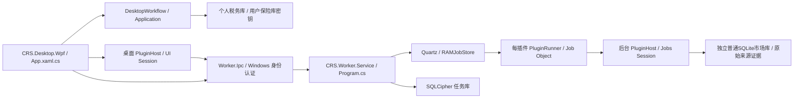

# 当前架构入口

2026-10-27 配置ETF的官方报告目录独立为`EtfHoldings`功能：Core合同、Jobs类型化用例/协议/存储/任务、Watch客户端与展示分别归档；后台九组用例、七个客户端合同。可选公共JSON查询合同与原来源预算配合，目录不批准具名持仓或历史完整性。候选包20项真实监督进程/管道检查通过，未替换已安装Worker，见[目录链路与剩余门槛](../implementation/NATIONAL_TEAM_ETF_REPORT_INDEX_20261027.md)。顶栏点击随后改用TitleBar原生Header区域，研究说明声明按钮移除，见[顶栏修复](../implementation/NATIONAL_TEAM_COMPACT_HEADER_20261027.md)。

2026-10-27 设置新增运行资料清理：固定合同归Common、设置端口归Application、WPF展示后台预览；Worker核验旧日志与历史升级副本，保留当前快照、至少两份完整历史副本、活动数据库/密钥/原件和维护记录。异步扫描/清理经认证IPC执行，维护锁与摘要核验控制实际删除；未替换已安装服务，见[实现与现场只读盘点](../implementation/CRS_RUNTIME_DATA_CLEANUP_20261027.md)。

2026-10-27 公共Excel读写进入`CRS.Documents/Excel`，Infrastructure保留券商/税务/绩效投影及敏感导出协调，见[文档层收拢](../implementation/CRS_DOCUMENTS_EXCEL_20261027.md)。插件菜单通过通用WPF契约移交窗口顶栏；`BeijingTime`归入Common，WPF转换器只适配绑定，见[紧凑顶栏](../implementation/NATIONAL_TEAM_COMPACT_HEADER_20261027.md)。

2026-10-27 ETF披露原件统一门槛：可比性、具名持仓、候选、NAV、历史回算及金融通知领取共用来源/Q15/首见/哈希核验。通知另冻结解除或撤销时的本次输入，沿原普通SQLite事务；正式数据迁移未执行。实现与验收边界见[原件一致性记录](../implementation/NATIONAL_TEAM_ETF_DOCUMENT_INTEGRITY_20261027.md)。

2026-10-27 具名ETF持有人候选接线：通用PDF读取迁入无业务依赖的`CRS.Documents`，富途与国家队共用；持有人模板、候选合同和用例分别归`EtfHoldings`功能目录。已登记原件经只读核验后解析，不自动升级人工确认。范围及剩余门槛见[候选接线](../implementation/NATIONAL_TEAM_ETF_HOLDER_CANDIDATES_20261027.md)。

2026-10-26 国家队模块续项：直接持股、预警及原件完整性实现独立，工作区端口按功能归档，旧聚合接口及时间兼容壳退役，公共正文读取进入 `CRS.Common`、顶部分类菜单进入`CRS.Plugin.Wpf`。验收查询有界批量读取并附只读阶段诊断。ETF核心、连接和初始化所有权已独立，国家队两库改为普通SQLite；后台另分八组类型化用例和统一执行会话，不再实现界面合同，六个客户端合同均要求显式实现。当前验证与剩余边界见[分层重构记录](../implementation/NATIONAL_TEAM_MODULAR_REFACTOR_20261026.md)。

2026-10-23反方评审R01～R04候选整改：Application显式联合导入提交、国家队独立只读快照与有界证据查询、正式源码组合根默认每插件Runner监督、ACL巡检与容量预警分离。工作区源码已接线，未替换已安装服务，验证与剩余边界见[四项整改](../implementation/ARCH_OPTIMIZATION_20261023.md)。

2026-10-23 阶段 2a 新增 RecoveryExportSession 内部确认/审计状态机及 ServiceKey.OpenExisting 只读入口；尚未接到 Worker 运行时/管道，未改变生产导出权限或调度流程。[验证与剩余接线门槛](../validation/WORKER_RECOVERY_EXPORT_AUTHORIZATION_20261023.md)。

2026-10-23 ServiceKey 灾备第一阶段：新增内部内存恢复封装组件与合成负例，未接入生产启动/IPC/CLI，主密钥仍由原有机器 DPAPI/SID/ACL 保护。授权导出、目标重封装/只读验库与激活尚未实现，详见[分阶段安全审查](WORKER_SERVICE_KEY_RECOVERY.md)；ARCH-005 / P0-02 保持 Open。

状态：Current（2026-10-20 Windows Release构建与依赖门禁已复核，生产发布门槛另行验收）；源码结构核对日期：2026-10-20。本文描述已接线的结构；设计提案和旧实施记录不能替代本文及源码。新增能力先核对本文、项目文件及启动入口，再参考旧方案。

## 解决方案生产项目与直接项目依赖

表中记录编译依赖。桌面项目另有 `ReferenceOutputAssembly=false`、`Private=false` 的开发打包构建依赖，确保 F5/普通构建先生成桌面插件及国家队后台入口；它们不进入宿主编译引用或输出根目录。项目循环检查仍包含这些构建依赖。

| 项目 | 直接项目依赖 | 职责 |
| --- | --- | --- |
| CRS.Domain | 无 | 交易事实、FIFO、税务及绩效规则 |
| CRS.Application | CRS.Common, CRS.Domain | 用例、端口、冻结结果、DesktopWorkflow |
| CRS.Security | 无 | 密码学、认证和保险库机制 |
| CRS.Infrastructure | CRS.Domain, CRS.Application, CRS.Security, CRS.Documents | 券商解析、持久化、汇率、导出、装配 |
| CRS.Desktop.Wpf | CRS.Application, CRS.Infrastructure, CRS.PluginHost, CRS.Worker.Ipc | 桌面进程，具体基础设施仅由 Composition 装配 |
| CRS.Plugin.Abstractions | CRS.Common | 桌面插件的 BCL 契约 |
| CRS.Common | 无 | 全CRS可复用的纯BCL能力：北京时间+08:00、JSON时间转换、读取公平租约、SHA256内容指纹、有界HTTP正文读取；不依赖业务或宿主 |
| CRS.Documents | 无 | 公共PDF文字/坐标读取、Excel工作表读取及工作簿生成；文件/行列限额、原始值与显示值分离；依赖PdfPig、NPOI及其运行库，不含券商、税务或持仓规则 |
| CRS.Plugin.Wpf | CRS.Plugin.Abstractions, CRS.Common | WPF页面贡献、通用分类菜单与宿主顶栏移交契约；时间转换器只适配绑定 |
| CRS.PluginHost | CRS.Plugin.Wpf | 桌面可信包、页面及生命周期 |
| CRS.Worker.Abstractions | CRS.Common | 后台会话、任务、查询及存储上下文契约 |
| CRS.Worker.PluginHost | CRS.Worker.Abstractions | 后台包验证及会话加载 |
| CRS.Worker.PluginRunner | CRS.Worker.PluginHost | 每插件监督进程、私有stdio双向协议、上下文能力代理；正式源码组合根已启动，部署另验 |
| CRS.Worker.Ipc | CRS.Worker.Abstractions | Named Pipes、Windows 身份授权及请求协议 |
| CRS.Notifications | CRS.Common | 公共多渠道通知契约、渠道注册表与邮件适配器；不依赖业务插件或Worker |
| CRS.Worker.Service | CRS.Worker.PluginHost, CRS.Worker.Ipc, CRS.Notifications | Windows Service、唯一 Quartz 调度和加密任务库；仅装配和授权调用公共通知组件 |
| CRS.Plugins.Demo | CRS.Plugin.Wpf | 桌面页面验证插件 |
| CRS.Plugins.Heartbeat | CRS.Worker.Abstractions | 后台心跳插件 |
| CRS.Plugins.NationalTeam.Core | CRS.Common | ETF 领域与只读契约文件实体归属 Core；无跨项目源码链接 |
| CRS.Plugins.NationalTeam.Jobs | CRS.Plugins.NationalTeam.Core, CRS.Worker.Abstractions, CRS.Plugin.Abstractions, CRS.Common, CRS.Documents | 后台采集、市场库、来源策略及查询 |
| CRS.Plugins.NationalTeamWatch | CRS.Plugins.NationalTeam.Core, CRS.Worker.Ipc, CRS.Plugin.Wpf | ETF 桌面展示，经 IPC 读取及提交管理命令 |

## 解决方案测试与夹具项目

以下清单与 `CRS.sln` 一起由 `tests/Verify-Architecture.ps1` 核验，新增/删除项目必须同步更新本文。

| 项目 | 用途 |
| --- | --- |
| CRS.Tests.Domain | 领域和复杂度门禁 |
| CRS.Tests.Application | 用例和历史复算 |
| CRS.Tests.Infrastructure | 适配器和持久化 |
| CRS.Tests.Security | 密码学与认证 |
| CRS.Tests.Wpf | 绑定、交互和窗口 |
| CRS.Tests.Verification | 样本及发布验证 |
| CRS.Tests.PluginHost | 桌面插件宿主 |
| CRS.Tests.PluginRecovery | UI插件包、页面资源与只读服务边界；Worker恢复另行验证 |
| CRS.Tests.NationalTeamWatch | ETF 业务与来源 |
| CRS.Tests.IndexResearch | 指数序列、估值及持久修订研究 |
| CRS.Tests.IndustryPe | 行业公布PE、修订、来源与历史位置 |
| CRS.Tests.SectorResearch | 行业质量、估值研究与反方规则 |
| CRS.Tests.SectorUi | 行业研究界面、分类导航与查询取消 |
| CRS.Tests.Background | Worker、管道、权限和调度 |
| CRS.Tests.WorkerEtf | ETF 双入口及后台存储 |
| CRS.Worker.FixturePlugin | 后台故障与慢查询夹具，不进入发行包 |
| CRS.Worker.EtfFixture | 隔离 ETF 服务夹具 |

## 进程与数据边界

WPF 负责展示与交互；Views/ViewModels/Controls 通过应用入口调用，不能解析文件、计算金额或直接连接数据库。后台没有 WPF、私人税务或保险库依赖。国家队领域模型与公共查询 DTO 实体位于 Core；采集、应用写用例、市场仓储及证据完整性作业位于 Jobs；UI 目录仅保留页面、ViewModel 与 IPC 客户端。桌面旧 Quartz 实现与桌面计划契约已从本整改分支移除，Quartz Cron 表达式编辑器仅负责解析和预览。WPF 退出不停止已安装服务。主程序没有静态引用业务插件；UI/Core/Jobs 的运行会话与容器不跨进程共享。

通知经独立公共组件CRS.Notifications的渠道契约与注册表发送；Worker组合根注册邮件适配器，插件只得到IBackgroundNotificationContext，不取得提供商凭据或收件目标。系统邮件设置经DesktopWorkflow和管理IPC配置。预警事件、输入快照、业务Outbox及提交历史留在国家队插件的同一普通SQLite市场库，事件与Outbox同事务；既有Quartz每5分钟驱动恢复评价和有界投递；独立 evidence-integrity 后台任务协调原件损坏/恢复状态（只读查询核验发现损坏立即拒绝返回，不持久化变更），采集/审核成功也触发评价，不另建调度器、数据库或服务。金融预警仍受真实数据门槛阻断，数据核查独立展示。详情见[通知边界](NOTIFICATION_CHANNELS.md)及[实施验收](../implementation/NATIONAL_TEAM_EXIT_ALERT_IMPLEMENTATION_20261019.md)。

正式 Worker 由 `src/CRS.Worker.Service/Program.cs` 固定组合，数据位于 `%ProgramData%/CRS/Background`，独占 `owner.lock`；服务 SID 和管理员 ACL 限制访问。调度库使用机器 DPAPI 主密钥，插件使用 HKDF 按插件 ID 派生的独立密钥与私有目录。个人税务库采用独立用户密钥域，默认 CRS/data。DPAPI 文件与数据库拷贝尚不构成跨机恢复方案。

Worker维护由`tools/background/Upgrade-Service.ps1`、`Recover-Service.ps1`及共用的`WorkerUpgradeTransaction.psm1`/`WorkerMaintenance.psm1`协调，另持maintenance.lock防止多个维护者争用；快照留在原私有数据树。ServiceWorker在Generic Host接入SCM后、打开密钥和仓储前执行`WorkerUpgradeJournal`，只接受已确认代次或经过备份校验的Switched候选。候选先持久标记可能有新事实，再打开数据；未提交即崩溃的候选不会自动再次打开数据。已结束事务的启动失败可显式ResumeConfirmed，必须匹配已确认发行指纹。详见[实际流程与剩余目标](../deployment/WORKER_UPGRADE_AND_RECOVERY.md)。

## IPC 与插件生命周期

协议真相位于 `src/CRS.Worker.Ipc`：只读和管理管道分离；读取经过 Windows 身份认证，修改要求管理员。版本不兼容、未知命令和不支持的查询必须显式失败。管理命令使用持久请求 ID 和修订号；响应不确定时重发原请求。Jobs/History 为有界游标分页，历史筛选在分页之前执行。

后台加载顺序：管理员控制的信任索引 → 完整包文件哈希/契约/依赖核验 → 启动受监督Runner并复核加载入口 → Start → 独立注册查询会话 → DescribeJobs → 注册持久计划 → Quartz。纯查询插件允许 DescribeJobs 为空。单包初始化失败隔离；不响应取消的插件由正式宿主终止对应Runner并确认退出以保护存储。停止先撤销请求、进入维护，取消并排空查询和任务，再释放会话、连接和密钥。插件查询不持 Worker 全局锁，同插件仅允许一个在途查询，超额返回 PluginBusy；普通查询异常不冒充任务仓储全局故障。

正式源码组合根现将**可信第一方插件放入独立Runner进程，仍不是权限沙箱**。私有继承stdio、包摘要/挑战/PID绑定与Job Object提供故障范围和资源约束；通知、来源预算和进度仍由Worker代理。相同服务身份不限制插件的OS文件/网络权限。安装器继续要求CMS发行签名，开发包需显式豁免，第三方权限隔离仍须评审。详见[隔离设计](WORKER_PLUGIN_PROCESS_ISOLATION.md)及[已接线范围](../implementation/ARCH_OPTIMIZATION_20261023.md)。旧V1原型入口仍仅供既有测试，正式监督入口使用独立V2协议。

## 后台并发与等待预算

2026-10-23 新增可选 `IGroupedBackgroundSession`。加载时校验分组声明，调度时同时约束插件与执行组，组内 FIFO；某组无额度的等待项不阻挡其他组。NationalTeam 默认采用采集/巡检 2、预警 1、管理 1，总并发 4，保留全局 8 与单插件上限。详见 [分组并发整改与验收边界](../implementation/NATIONAL_TEAM_CONCURRENCY_20261023.md)。

Quartz仍是唯一执行生命周期所有者。`BackgroundRuntime.Scheduling.cs`在短管理门槛内用`Wait(0)`尝试插件额度，不能执行的作业立即释放Quartz名额，进入每插件有界FIFO；额度释放后唤醒队首，不启动脱离Quartz管理的工作。相同任务只留一个等待项，自动重复触发合并；自动任务超额暂不执行，手动请求在持久化前超额返回PluginBusy。已接收手动命令保持持久幂等和重启恢复，暂停/取消清除对应等待项。

全局并发来自私有数据目录的`worker-settings.json`，缺省固定为8；显式MaxConcurrency支持1–32，显式设为0时才按CPU逻辑处理器数取4–16。MaxPendingPerPlugin缺省16，支持1–32。管理员修改后重启生效，例如`{"MaxConcurrency":8,"MaxPendingPerPlugin":16}`；文件不随不可变程序包覆盖，未知字段/非法值拒绝启动。这里的数值是并行作业额度，并非专属物理线程数量。

旧插件会话默认串行；线程安全会话可实现`IConcurrentBackgroundSession`声明1–32并发，实际额度不超过全局并发的一半（至少1），给其他插件保留容量。相同Job仍不重入。健康响应增加可选Scheduling，报告全局运行/宿主等待、持久待执行手动命令、插件额度与运行/等待数、合并和容量延后计数；宿主等待数不包含Quartz内部尚未分派的触发器。协议版本仍为2。跨插件共享来源预算和持续超载验收仍待完成，不能承诺任意负载零积压。

## 系统设置展示边界

系统设置采用分组树目录、分类关键词搜索、当前位置及独立滚动页，分类集中登记在 `SettingsViewModel.Navigation.cs`。页面切换保留草稿，锁定/关闭清空临时凭证。分类导航不承接持久化、认证或通知发送；数据库、日志、保险库与公共通知仍沿既有应用端口处理。扩展约定及真实窗口验证见[设置分类导航](../implementation/SETTINGS_NAVIGATION_20261019.md)。

## 自动检查和仍未关闭项

`tests/Verify-Architecture.ps1` 核验项目存在性、循环依赖、项目清单一致性、领域及前台边界、后台无私人税务/WPF依赖、宿主无业务插件静态引用。完整构建后执行门禁，参见 `tests/README.md`。

升级事务、跨机灾备、历史完整执行环境、官方交易日历及长期来源验收、多插件公平资源预算尚待闭环，详见 [本轮整改记录](../implementation/ARCH_REMEDIATION_20261016.md)。独立税务金额验收 ARCH-001 按本轮要求最后处理；现有回归测试不能替代真实账户独立签认。

## 2026-10-20手工绩效输入边界

账户、投资事件、净值和完整性确认通过 `IPerformanceUseCases` 的类型化用例提交；Application构造业务对象、校验来源/完整性/金额并复用归档路径，WPF只映射表单。删除已无生产调用的旧桌面任务页面，正式计划继续只由Worker拥有。验证范围和部署状态见[架构整改续记](../implementation/ARCHITECTURE_REMEDIATION_20261020_CONTINUED.md)。

NationalTeam插件业务DTO现由Core的`EtfBusinessProtocol`独立管理V1版本；未知版本明确拒绝。Host IPC 2、加载契约2.0及市场持久Schema2仍独立，兼容范围见[业务契约](NATIONALTEAM_BUSINESS_CONTRACT.md)。

旧进程内Catalog在超出协作取消收尾期后仍进入需要进程重启的终止状态，保留退出码2的存储保护策略。正式源码组合根使用Runner代理，失控时只终止对应进程树并确认退出，记录结果未知，按冷却和启动预算恢复；Worker及其余插件继续响应。生命周期日志仅含插件ID、阶段和分类，见[四项整改](../implementation/ARCH_OPTIMIZATION_20261023.md)。

IBKR税务/绩效/现金对账/账号展示通过统一`IbkrSourceReader`消费Application不可变`BrokerSourceDocument`；证券流水同步绩效传递实际来源快照，不重复解析。投影与算法仍独立；绩效导入及新历史已保存读取/投影版本，设置JSON写2、读1，税务独立历史版本和完整类型化投资事实尚未关闭，见[共享来源事实](BROKER_SOURCE_FACTS.md)。

## ARCH-209宿主共享来源预算（2026-10-20）

Worker组合根唯一创建来源注册表，通过可选BCL端口绑定插件身份。正式网关已接入，SSE/SZSE/已审核发行人分别共享并发、频率、FIFO和持久退避；会话启动预合并旧策略，新增SQLCipher库与只读健康字段。详见[共享预算边界](SHARED_SOURCE_BUDGETS.md)。本次未更新已安装服务；长期负载和正式恢复验收继续开放。

ARCH-209后续：新增来源状态启动前校验；已初始化库缺表、损坏日期、失败计数越界及未知版本拒绝启动。来源存储异常后，Worker健康仍返回可读StorageFault，来源快照为null，不返回空来源或Ready；新增执行与插件查询继续失败关闭。库版本仍为1，本次不更改金融Schema、密钥域或服务运行标识。有限持续负载入口与最终证据见[共享来源预算](SHARED_SOURCE_BUDGETS.md)及[续记](../implementation/ARCHITECTURE_REMEDIATION_20261020_CONTINUED.md)，跨日与实际部署门槛仍开放。

## 数据库替换约束

业务层通过仓储端口操作业务对象；连接、事务、SQL方言、迁移与加密备份留在具体存储实现。共享来源预算已以ISourceBudgetStore注入，Program装配SqliteSourceBudgetStore，预算规则不再创建数据库。当前仍为SQLite/SQLCipher，其他模块的剩余耦合与迁移验收见[数据库抽象与替换边界](DATABASE_PORTABILITY.md)。

Worker任务仓储的运行期SQLite异常现由适配器转为IO故障；BackgroundRuntime不再引用具体SQLite类型，插件遗留异常暂以通用DbException兼容。ITaskRepository明确原子提交与游标边界，数据库迁移仍按上述规范独立验收。

## 保险库与插件存储族选择

VaultManager现为IVaultStorageBackend转发入口，原SQLCipher会话/认证/备份实现归Storage/SqlCipher。DesktopOperations依赖存储族端口；国家队后台入口通过NationalTeamStorageProviders选择市场仓储及ISourceRequestPolicy，网关不再依赖SourceRequestPolicy具体类。桌面和Worker分别读取其运行目录config/storage-providers.json的Vault/NationalTeam字段；保险库内置sqlcipher、国家队内置sqlite，未注册类型拒绝；旧国家队加密文件须显式离线保留式导出，不自动迁移或热切换。完整注册、配置及验收边界见[数据库可插拔规范](DATABASE_PORTABILITY.md)。未新增项目或反向项目依赖。

ARCH-208税务审计补强：IBKR新年度/期初报告的TaxImportProvenance随结果在现有仓储原子持久化并受整份结果封存保护；旧记录保持未知，重放与年度汇总沿用历史依据，底稿列出解析版本。此项不改税务/FIFO/汇率规则，富途税务三类来源版本现已接入，完整类型化事实、跨版本差异及独立金额验收仍开放。

Worker源码目录按职责收拢：运行规则在Runtime，来源预算在Sources，仓储接口在Persistence、SQLCipher实现位于Persistence/SqlCipher；宿主上下文、安全、通知、日志及升级分别归Hosting/Security/Notifications/Diagnostics/Deployment。目录调整不改变命名空间或运行标识，详见[目录说明](../../src/CRS.Worker.Service/README.md)。
2026-10-20：公共通知新增钉钉加签机器人及个人微信PushPlus适配器，经管理员IPC配置，WPF仅保留表单；见 [通知渠道边界](NOTIFICATION_CHANNELS.md)。配置默认关闭，尚无真实通道送达验收。
IPC分段超时、旧构造器兼容及市场质量状态索引已落地验收；相关服务维护代次与品牌区布局见[修复记录](../implementation/IPC_EOF_BRAND_HEADER_20261020.md)。该实际部署保留原宿主实现，共享来源预算部署状态不能由此推定完成。
桌面国家队插件StartAsync只建立展示模型；首次ETF数据查询由页面Loaded触发并在会话内共享初始任务，不占用宿主15秒启动期限。数据读取失败不撤销已注册页面，页面仍允许手动重试；后台查询期限和金融证据校验不变。
ETF默认目录由纯领域InitialEtfDirectory统一维护，数据库适配器幂等落库，不覆盖用户配置；页面先读配置再读份额。原件批校验在释放读取器后最多四路访问只读文件句柄，数据库连接始终留在应用串行门槛内，不跨查询缓存完整性结论。详见[目录与份额加载](../implementation/ETF_DIRECTORY_AND_SHARE_LOADING_20261021.md)。

2026-10-23 续项：市场仓储分为必需业务端口，正式会话启动核验独立读取等能力；计算年度统一北京时间。灾备仅新增内部加密授权索引、重放保护及审计故障边界，生产恢复入口/目标激活和跨机演练仍未完成，见[实施记录](../implementation/ARCH_FOLLOWUP_20261023.md)。
