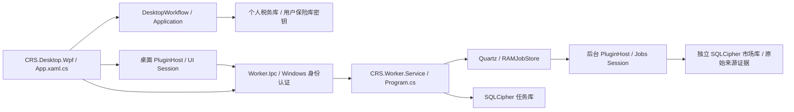

# 当前架构入口

状态：Current；源码核对日期：2026-10-16。本文描述已接线的结构；设计提案和旧实施记录不能替代本文及源码。新增能力先核对本文、项目文件及启动入口，再参考旧方案。

## 解决方案生产项目与直接项目依赖

| 项目 | 直接项目依赖 | 职责 |
| --- | --- | --- |
| CRS.Domain | 无 | 交易事实、FIFO、税务及绩效规则 |
| CRS.Application | CRS.Domain | 用例、端口、冻结结果、DesktopWorkflow |
| CRS.Security | 无 | 密码学、认证和保险库机制 |
| CRS.Infrastructure | CRS.Domain, CRS.Application, CRS.Security | 券商解析、持久化、汇率、导出、装配 |
| CRS.Desktop.Wpf | CRS.Application, CRS.Infrastructure, CRS.PluginHost, CRS.Worker.Ipc | 桌面进程，具体基础设施仅由 Composition 装配 |
| CRS.Plugin.Abstractions | 无 | 桌面插件的 BCL 契约 |
| CRS.Plugin.Wpf | CRS.Plugin.Abstractions | WPF 页面贡献契约 |
| CRS.PluginHost | CRS.Plugin.Wpf | 桌面可信包、页面及生命周期 |
| CRS.Worker.Abstractions | 无 | 后台会话、任务、查询及存储上下文契约 |
| CRS.Worker.PluginHost | CRS.Worker.Abstractions | 后台包验证及会话加载 |
| CRS.Worker.Ipc | CRS.Worker.Abstractions | Named Pipes、Windows 身份授权及请求协议 |
| CRS.Worker.Service | CRS.Worker.PluginHost, CRS.Worker.Ipc | Windows Service、唯一 Quartz 调度和加密任务库 |
| CRS.Plugins.Demo | CRS.Plugin.Wpf | 桌面页面验证插件 |
| CRS.Plugins.Heartbeat | CRS.Worker.Abstractions | 后台心跳插件 |
| CRS.Plugins.NationalTeam.Core | 无 | ETF 领域与应用模型，共享源码边界见项目文件 |
| CRS.Plugins.NationalTeam.Jobs | CRS.Plugins.NationalTeam.Core, CRS.Worker.Abstractions, CRS.Plugin.Abstractions | 后台采集、市场库、来源策略及查询 |
| CRS.Plugins.NationalTeamWatch | CRS.Plugins.NationalTeam.Core, CRS.Worker.Ipc, CRS.Plugin.Wpf | ETF 桌面展示，经 IPC 读取及提交管理命令 |

## 解决方案测试与夹具项目

以下清单与 `CRS.sln` 一起由 `tests/Verify-Architecture.ps1` 核验，新增/删除项目必须同步更新本文。

| 项目 | 用途 |
| --- | --- |
| CRS.Tests.Domain | 领域和复杂度门禁 |
| CRS.Tests.Application | 用例和历史复算 |
| CRS.Tests.Infrastructure | 适配器和持久化 |
| CRS.Tests.Security | 密码学与认证 |
| CRS.Tests.Wpf | 绑定、交互和窗口 |
| CRS.Tests.Verification | 样本及发布验证 |
| CRS.Tests.PluginHost | 桌面插件宿主 |
| CRS.Tests.PluginRecovery | 插件升级恢复 |
| CRS.Tests.NationalTeamWatch | ETF 业务与来源 |
| CRS.Tests.Background | Worker、管道、权限和调度 |
| CRS.Tests.WorkerEtf | ETF 双入口及后台存储 |
| CRS.Worker.FixturePlugin | 后台故障与慢查询夹具，不进入发行包 |
| CRS.Worker.EtfFixture | 隔离 ETF 服务夹具 |

## 进程与数据边界

WPF 负责展示与交互；Views/ViewModels/Controls 通过应用入口调用，不能解析文件、计算金额或直接连接数据库。后台没有 WPF、私人税务或保险库依赖。WPF 退出不停止已安装服务。主程序没有静态引用业务插件；UI/Core/Jobs 的运行会话与容器不跨进程共享。

正式 Worker 由 `src/CRS.Worker.Service/Program.cs` 固定组合，数据位于 `%ProgramData%/CRS/Background`，独占 `owner.lock`；服务 SID 和管理员 ACL 限制访问。调度库使用机器 DPAPI 主密钥，插件使用 HKDF 按插件 ID 派生的独立密钥与私有目录。个人税务库采用独立用户密钥域，默认 CRS/data。DPAPI 文件与数据库拷贝尚不构成跨机恢复方案。

Worker维护由`tools/background/Upgrade-Service.ps1`、`Recover-Service.ps1`及`WorkerMaintenance.psm1`协调，另持maintenance.lock防止多个维护者争用；快照留在原私有数据树。ServiceWorker在Generic Host接入SCM后、打开密钥和仓储前执行`WorkerUpgradeJournal`，只接受已确认代次或经过备份校验的Switched候选。候选先持久标记可能有新事实，再打开数据；未提交即崩溃的候选不会自动再次打开数据。详见[实际流程与剩余目标](../deployment/WORKER_UPGRADE_AND_RECOVERY.md)。

## IPC 与插件生命周期

协议真相位于 `src/CRS.Worker.Ipc`：只读和管理管道分离；读取经过 Windows 身份认证，修改要求管理员。版本不兼容、未知命令和不支持的查询必须显式失败。管理命令使用持久请求 ID 和修订号；响应不确定时重发原请求。Jobs/History 为有界游标分页，历史筛选在分页之前执行。

后台加载顺序：管理员控制的信任索引 → 完整包文件哈希/契约/依赖核验 → 加载入口 → Start → DescribeJobs → 注册持久计划 → Quartz。单包初始化失败隔离；不响应取消的插件由正式宿主终止进程保护存储。停止先撤销请求、进入维护，取消并排空查询和任务，再释放会话、连接和密钥。插件查询不持 Worker 全局锁，同插件仅允许一个在途查询，超额返回 PluginBusy；普通查询异常不冒充任务仓储全局故障。

当前插件是**受信任同进程代码，不是沙箱**。ALC 和哈希不限制操作系统权限。生产安装器要求外部指定发布者并验证 CMS 发行签名；开发包需显式豁免。运行时信任索引依赖管理员保护，尚未形成完整的签名轮换及第三方隔离体系。任何第三方支持须另行评审。

## 自动检查和仍未关闭项

`tests/Verify-Architecture.ps1` 核验项目存在性、循环依赖、项目清单一致性、领域及前台边界、后台无私人税务/WPF依赖、宿主无业务插件静态引用。完整构建后执行门禁，参见 `tests/README.md`。

升级事务、跨机灾备、历史完整执行环境、官方交易日历及长期来源验收、多插件公平资源预算尚待闭环，详见 [本轮整改记录](../implementation/ARCH_REMEDIATION_20261016.md)。独立税务金额验收 ARCH-001 按本轮要求最后处理；现有回归测试不能替代真实账户独立签认。
