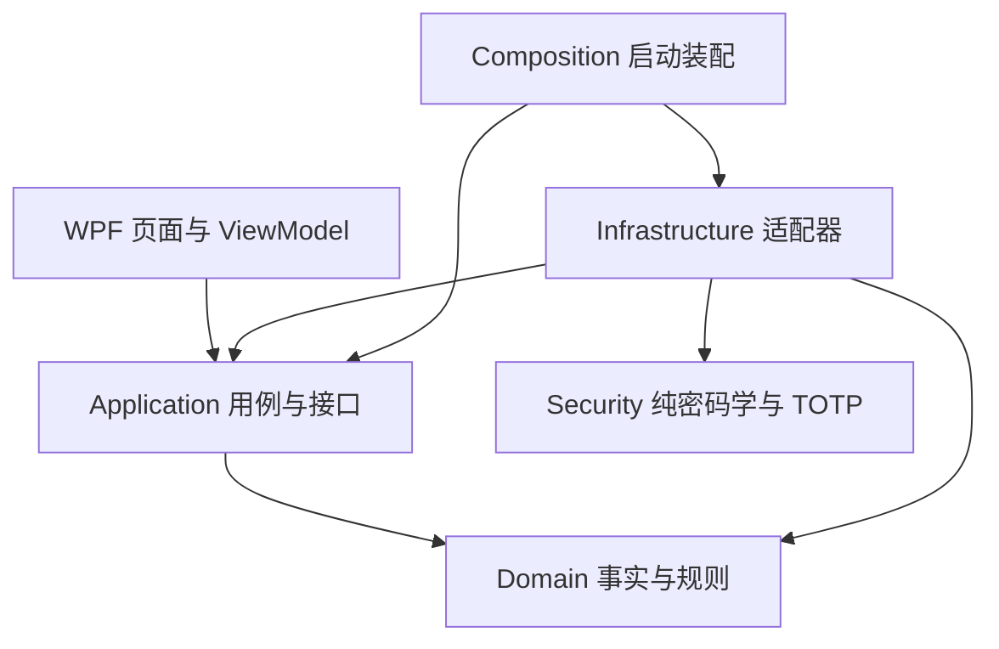

# 项目结构与分层约定

## 当前结构（五个生产项目，含独立 CRS.Security）

```text
CRS/
├─ CRS.sln
├─ Directory.Build.props
├─ Directory.Packages.props
├─ src/
│  ├─ CRS.Domain/
│  │  ├─ Trades/
│  │  ├─ FIFO/
│  │  ├─ ExchangeRates/
│  │  └─ TaxRules/
│  ├─ CRS.Application/
│  │  ├─ Abstractions/
│  │  ├─ Imports/
│  │  ├─ TaxCalculation/
│  │  ├─ Reconciliation/
│  │  ├─ Reporting/
│  │  └─ Workflows/
│  ├─ CRS.Security/                # Cryptography、Vault、Recovery、Authentication
│  ├─ CRS.Infrastructure/
│  │  ├─ Persistence/
│  │  ├─ Brokers/IBKR, FUTU/Pdf
│  │  ├─ Imports/                  # 原件单次读取、只读内存副本与同源摘要
│  │  ├─ ExchangeRateProviders/
│  │  ├─ Exports/
│  │  ├─ Configuration/
│  │  ├─ Security/
│  │  └─ Composition/
│  └─ CRS.Desktop.Wpf/
│     ├─ config/
│     ├─ Views/Pages/
│     ├─ ViewModels/
│     ├─ Controls/
│     ├─ Styles/
│     ├─ Converters/
│     ├─ Services/
│     └─ Composition/
├─ tests/
│  ├─ CRS.Tests.Domain/
│  ├─ CRS.Tests.Application/
│  ├─ CRS.Tests.Security/
│  ├─ CRS.Tests.Infrastructure/
│  ├─ CRS.Tests.Wpf/
│  ├─ CRS.Tests.Verification/
│  ├─ fixtures/
│  └─ Verify-Architecture.ps1
├─ docs/
│  ├─ guides/                       # 使用指南
│  ├─ architecture/                 # 产品与架构
│  ├─ implementation/               # 当前实现
│  ├─ specifications/               # 设计目标
│  ├─ validation/                   # 验证与验收
│  ├─ archive/                      # 历史记录
│  └─ examples/                     # 输入清单示例
└─ Sample/                          # 本地真实样本，不入 Git
```

## 当前依赖方向

当前 Domain 不引用外层或桌面包；Application 只引用 Domain；Infrastructure 实现 Application 的接口并使用领域事实，同时引用独立 Security 完成纯密码学与 TOTP 机制。Security 不引用其他生产项目。前台的 Views / ViewModels / Controls 只使用 Application 用例和展示模型。具体 Infrastructure 类型由 Composition 创建。安全实现与边界见 [AUTH_IMPLEMENTATION.md](../guides/AUTH_IMPLEMENTATION.md)。



Application/Abstractions/IDesktopUseCases 是 WPF 前台入口，前台不能获取仓储、解析器或输出适配器。设置窗口通过 IDesktopSettingsService 读写选项；持久化和目录校验由 Infrastructure 执行。IDesktopOperations 留作后台装配端口，不提供给页面。计算、保存、历史读取、复核和导出在后台执行；对话框、导航与取消交互留在前台。

WinForms 项目和 AntdUI 已于 2026-10-10 删除，当前只保留 WPF 前台。数据库默认使用 CRS/data，不自动识别旧版本目录。

年度计算分为 AnnualInputPreparation（账户、报告覆盖与期初成本检查）、CalculationService（计算流程与结果封装）和 AnnualReconciliation（持仓、卖出收益、现金核对）。卖出收益核对按完整证券身份和卖出编号索引 FIFO 匹配批次，避免每笔卖出重复扫描年度底稿。

ReplayExecutionContext 校验历史年度、规则与算法标识，提供历史汇率、配置指纹与临时状态。缺少冻结汇率时拒绝重放，不访问当前配置。CalculationService 可注入 TimeProvider；生产默认系统时钟。执行身份由 RunEvidenceSeal 校验，复算比较全部业务输出；完整运行时／依赖身份与跨版本兼容仍未闭环。

CalculationResult、ImportData、历史索引和规范化快照位于 Application；金额计算规则及交易事实位于 Domain。AppliedRate 仅表达汇率和来源事实；JSON 文件、HTTP 和缓存由 Infrastructure 提供。人工复核说明在 Application 校验，数据库适配器仍保留防御性约束。

## WPF 页面

ShellViewModel 组装页面与 WorkspaceState；WorkspaceState 共享当前冻结结果、汇率指纹、复核依据及忙碌状态。ImportViewModel、ResultsViewModel、DashboardViewModel、HistoryViewModel、ReviewViewModel、ReportsViewModel 和 ExchangeRatesViewModel 分别处理自己的展示与交互。

NavigationView 缓存概览、导入、交易、FIFO、汇率、税务、核对、导出和历史九个页面。概览卡片和任务列表可导航到真实内容。ResultTabs 复用只读底稿，DataGridExtensions 提供列筛选；LiveCharts 显示后台金额并随结果切换更新。尚未接入行情服务。

侧栏支持折叠为图标；SettingsWindow 管理日志与数据库选项。富途收入和交易文件独立替换与清除。金额保持 decimal，展示格式化不重新计算税额。输入改变会同时清除各页面旧结果、图表、人工依据及导出资格；后台运行时共享门槛阻止跨页面重复提交。

## 兼容与验证

SQLCipher 位置保持原有语义，业务结构为 user_version=2；加密 v1 库先备份后事务升级，旧 JSON 不改写。旧 JSON 按属性读取，新字段允许缺失；交易笔数缺失显示“未登记”，真实零笔显示 0。SessionTrades 不参与 JSON 持久化。完整规范化快照遵循用户选项。新任务程序文件归档与读取校验见 [DATABASE_UPGRADE.md](../implementation/DATABASE_UPGRADE.md)。

各业务命名空间现在为 CRS.Domain / CRS.Application / CRS.Infrastructure。WPF 实现命名空间为 CRS.DesktopClient，避免生成代码中的 Wpf.Ui 名称解析冲突；项目名为 CRS.Desktop.Wpf。

[验证说明](../../tests/README.md)记录 Release 构建、架构门槛、分层测试、综合回归及窗口检查。后台规则和存量业务缺口继续按既有整改记录处理。

## 安全模块职责与准入

CRS.Security 已是独立生产项目，包含 Cryptography、Vault、Recovery、Authentication；不提供 SQLCipher、文件 I/O 或业务仓储。VaultManager、VaultSession、分块备份与恢复适配位于 Infrastructure/Security，数据库表和事务位于 Infrastructure/Persistence。原目标树中的 Infrastructure/Backup 并非当前目录；设计原稿见 [历史结构提案](../archive/SECURITY_STRUCTURE_PROPOSAL.md)。

| 项目 | 允许引用的生产项目 | 约束 |
| --- | --- | --- |
| CRS.Domain | 无 | 交易事实、FIFO 与税额规则 |
| CRS.Application | CRS.Domain | 用例编排与端口，不引用 Security 或 Infrastructure |
| CRS.Security | 无 | 纯密码学、恢复与 TOTP 机制 |
| CRS.Infrastructure | Domain、Application、Security | SQLCipher、事务、文件与外部适配 |
| CRS.Desktop.Wpf | Application、Infrastructure | 基础设施仅用于启动装配，页面不取得密钥或仓储 |

首次／恢复由主密码或数据库恢复密钥解封 DEK；日常由 DPAPI CurrentUser 本机槽准备访问。手机验证启用时必须完成 TOTP 原子消费；关闭时完整初始化的保险库可以本机直接进入。默认 10 分钟自动锁定，便携备份不含 Windows 本机槽。详细流程见 [认证](../guides/AUTH_IMPLEMENTATION.md)。

仅支持已验证的 SQLCipher 及明确识别的加密 v1→v2 结构升级；明文 SQLite 只识别并拒绝，不读取、转换或覆盖。加密备份恢复到新空目录；手机恢复码与数据库恢复密钥用途不同。当前实现及限制见 [数据库升级](../implementation/DATABASE_UPGRADE.md)、[备份容量](../implementation/BACKUP_CAPACITY.md) 和 [锁定中断](../implementation/LOCK_INTERRUPTION.md)。


## 投资绩效模块

Domain/Performance 存放独立净值、流量、TWR/XIRR 与区间市场成本引擎；Application/Performance 暴露端口与冻结运行；Infrastructure/Performance 解析原件、存储 SQLCipher 和导出；WPF 的 PerformanceViewModel/PerformancePage 提供第十个页面。实现说明见[绩效 P0](../implementation/PERFORMANCE_P0.md)。
