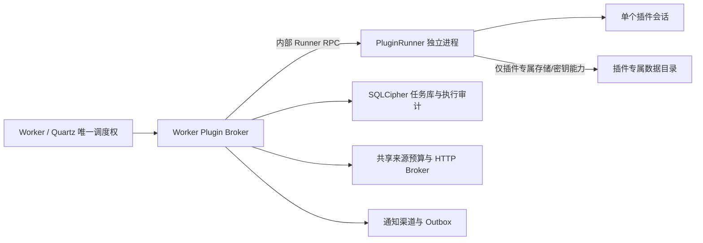

# Worker 后台插件进程隔离设计

状态：**第一方进程故障隔离已接入正式源码组合根，工作区验证中；未替换已安装服务，不构成OS权限沙箱**（2026-10-23）。本轮采用父子进程私有继承stdio及独立V2双向协议，实现上下文/进度/通知/来源代理和Job Object监督；旧V1原型保留测试入口。下文保留分阶段目标及OS安全隔离门槛，实际接线与证据以[四项整改记录](../implementation/ARCH_OPTIMIZATION_20261023.md)为准。

范围：CRSTool 的 Windows Service、后台插件加载/执行、内部 IPC、插件私有数据、通知和来源预算。此文档是 P1-07 的设计入口，不授权立即改变正式服务、数据目录、密钥、插件 ID/Job ID、持久化 Schema 或现有桌面 Worker IPC。

## 1. 决策摘要

保持 Worker 是唯一的 Quartz 调度者、任务计划/执行记录权威、SQLCipher 服务主密钥持有者和通知/来源预算策略执行者。引入独立 PluginRunner 进程作为**可逐插件启用的故障隔离边界**，先用无网络、无敏感数据的夹具和 Heartbeat 插件验证内部 RPC，再迁移需要长时间采集/查询的第一方插件。

必须严格区分两个目标：

1. **故障隔离**：插件崩溃、死锁、失控取消或资源消耗不应强迫整个 Worker 进程退出。独立进程 + Job Object 可以帮助实现。
2. **安全隔离**：插件不能读取兄弟插件数据/密钥、任意访问文件系统或绕过来源预算直接联网。**单独把 DLL 放进子进程、继续使用同一 Windows 身份和原权限，不满足这一目标。**

第一阶段只承诺故障隔离，不宣称沙箱。第三方/不受信插件在第二阶段的 Windows 身份、ACL、网络与密钥边界通过安全评审前不开放。

## 2. 整改前事实与风险

源码：`src/CRS.Worker.PluginHost/BackgroundPluginCatalog.cs`、`src/CRS.Worker.Service/Program.cs`、`src/CRS.Worker.Service/Hosting/WorkerPluginContext.cs`、`src/CRS.Worker.Abstractions/Contracts.cs`。

- Worker 内的 `BackgroundPluginCatalog` 使用可收集的 `AssemblyLoadContext`，验证受信索引、包内哈希、加载契约和依赖；有生命周期超时、异常分类和不合作插件的终止状态。
- 所有插件代码仍运行在 Worker 进程与服务令牌内。ALC/哈希约束包身份和程序集加载，不限制文件、网络、原生调用、进程内存或 `Environment.Exit`。
- `WorkerPluginContext` 向插件提供每插件数据目录、HKDF 派生数据密钥、通知 API 和来源预算 API。派生密钥优于主密钥直传，但同进程代码仍与宿主共享内存和 OS 权限。
- Worker 为了避免释放仍被插件使用的 SQLCipher/Quartz 资源，目前在插件不响应取消收尾时使用既有进程退出策略。该策略保护数据生命周期，但一个插件可扩大成全 Worker 故障。
- 来源预算是合作式能力端口，不是 OS 网络沙箱；插件如果拥有直接 HTTP 能力，单靠租约接口无法阻止其绕过预算。桌面 Worker IPC v2 不应被复用为插件控制协议。

结论：目前属于**管理员控制、受信第一方插件**模型。不得把“包已哈希验证”解释成“代码已沙箱化”。

## 3. 目标组件与职责

- **Worker / Broker**：校验插件包、创建进程、持有任务/执行/审计状态、实施并发/来源/通知/存储授权、监控进程退出、决定重启/熔断。
- **PluginRunner**：每个进程只加载一个插件包；执行 Start/DescribeJobs/Execute/Query/Stop；不运行 Quartz，不连接 Worker 任务库，不创建第二个调度器。
- **Runner IPC**：只承载版本化、有限大小、可取消的请求/响应和能力调用；不传递 .NET 委托、对象图、任意类型名、文件路径或根服务容器。
- **插件进程监督器**：为每个子进程持有 OS 进程句柄和 Job Object；只在确认旧进程退出后才允许对同一插件重启，避免两个进程同时写同一插件数据库。

## 4. 内部协议与启动信任

内部 Runner 协议独立版本化，不修改桌面与管理端使用的 `WorkerProtocol.Version=2`，也不混同 `plugin.json hostContract=2.0` 或 NationalTeam 业务 DTO 版本。

### 启动握手

1. Worker 验证管理员控制的信任索引、包清单、每个文件哈希和插件加载契约；程序包目录由安装器保护为运行时只读。
2. Worker 为该插件分配一个独立私有管道/通信端点，并创建子进程。不得把密钥、一次性授权 token 或完整配置放入命令行、环境变量或明文临时文件。
3. 握手绑定 Runner 协议版本、插件 ID、包版本、包清单哈希、随机 nonce、父进程期望的 PID/进程句柄和启动期限。插件 ID 来自 Worker 创建的会话，不接受子进程自报身份作为授权依据。
4. 服务端管道 ACL 仅允许 Worker 服务 SID、经设计确认的 Runner 身份、SYSTEM/管理员；拒绝网络 SID。Worker 还要核验连接方 Windows 身份和进程身份，不能只靠随机管道名。
5. 对不兼容版本、错误包哈希、错误 PID/身份、重复握手、超时和过大帧明确拒绝；不得自动降级到旧协议重试。

### 请求集合

最小集合：`Start`、`DescribeJobs`、`Execute`、`Query`、`Stop`、`Cancel`、`Progress`、`Heartbeat`。所有调用包含 RequestId/ExecutionId、插件绑定上下文、有限 deadline 和明确的结果类别。进度与查询返回继续使用现有有界 DTO；禁止将异常正文、URL 参数、秘密或任意堆栈回传给公开日志。

## 5. 能力边界与敏感数据

### Worker 必须继续拥有

- Quartz 触发器、持久计划、命令幂等键、执行历史、取消/排队、来源预算、邮件/Webhook 凭据、发送目标和审计。
- 服务主密钥及其派生策略。任何插件都不得得到 Worker 主密钥、任务数据库连接或根 DI 容器。
- 来源域名/路径许可、并发和频率预算、冷却/Retry-After、HTTP 超时/响应体大小及网络失败策略。
- 插件进程的生命周期、资源上限、重启预算和健康状态。

### 插件能力的过渡策略

- **第一阶段故障隔离**：允许已审核第一方插件通过明确的 IPC 能力访问自己的私有数据、通知和来源预算。若临时传递插件派生密钥或数据目录，只允许专属数据域；文档/界面必须明确这仍不构成 OS 安全沙箱。
- **第二阶段安全隔离**：优先把文件和数据库访问收敛为 Worker Broker 的窄存储 API。若业务确需插件直接打开自己的 SQLCipher 库，则必须为每插件建立独立 OS 权限/ACL，且只授权该插件目录；通过经过安全评审的方式将其派生密钥传递给该 Runner。不能只依赖路径字符串约定。
- 通知继续由 Worker 按现有渠道/配置发送；插件只能提交消息 ID、标题、正文、类别及有界属性，不得读取凭据或收件目标。
- 来源租约必须由 Worker 端生成和回收，按已验证的进程/插件身份计费；租约过期、子进程退出或取消时释放。若要阻止插件绕过预算直接联网，必须在安全阶段将网络请求迁移到 Worker HTTP Broker，或用已验证的 OS 网络限制阻止 Runner 直连；合作式预算端口本身不等于网络限制。

## 6. 故障、取消与资源治理

- Start/Describe/Query/Execute/Stop 各阶段有独立期限；超时后先发 Cancel，等待有界收尾，仍不退出则终止对应 Job Object 中的 Runner 进程树。
- Runner 退出或被杀后，Worker 只将受影响插件的在途执行标记为失败/中断/结果未知，不因单个插件故障退出 Worker。宿主任务存储或审计损坏仍由 Worker 自身的 fail-closed 规则处理。
- 对可能已写入业务数据的执行，不得仅因为 Runner 退出就用新 RequestId 自动重放；沿用现有持久幂等键和业务补偿策略。结果未知必须能在任务中心中辨识。
- 每插件最多一个 Runner 实例；重启前确认旧进程退出、管道关闭、连接释放。重启采用有界指数退避/熔断（建议 10 分钟窗口最多 3 次，参数待压测确认），连续失败后将插件置为 Disabled/NeedsAttention，需管理员恢复。
- Job Object 设定活动进程数、内存和 CPU 预算；进程启动/退出、工作集、重启次数、最后阶段、错误分类进入 Worker 诊断，不记录敏感 payload。
- Worker 停机时先拒绝新执行，取消在途工作，等待期限后只终止各 Runner；确认子进程均退出后才释放插件数据库、来源预算、密钥和全局 owner lock。

## 7. Windows 身份和 ACL：安全隔离的硬门槛

将 Worker 的子进程直接以相同 LocalService token 启动，只改善崩溃/卡死的故障域，不是安全沙箱。相同身份仍可能拥有相同文件、网络和进程访问权限。

在承诺第三方或不受信插件前，必须先做 Windows 原型验证并选择一种受支持、可审计的身份方案，例如受限 token + 唯一限制 SID，或由 SCM 管理的独立 Runner 服务身份。验证至少包括：

- Runner 无权读取其他插件目录、Worker 主密钥、任务库、日志中的敏感文件和其他插件的派生密钥。
- Runner 不能修改 Program Files 下的 Worker/Runner/插件程序集或信任索引。
- Worker 通过最小权限 IPC 授予能力；未经授权的本地进程、其他插件进程和远程客户端均不能连接。
- 文件系统权限与 OS 网络策略在重启、升级、卸载/重装后保持一致；不存在因 LocalService 共享身份而自动获得的广泛权限。
- 若这些限制无法在目标 Windows 版本上可靠实施，则仅对管理员签署/审核的第一方插件启用进程故障隔离，不发布“安全沙箱”或第三方插件市场能力。

## 8. 分阶段实施计划

| 阶段 | 内容 | 退出条件 |
|---|---|---|
| A. 协议与威胁模型 | 固定 Runner RPC DTO、版本、错误类别、握手、管道 ACL、威胁模型和不支持的能力 | 契约测试、滥用场景和兼容矩阵通过；未改变现有运行路径 |
| B. 监督器与夹具 | Worker 启动一个合成 Runner；Job Object、PID/身份绑定、取消、强杀和健康状态 | 崩溃/死锁/超时只影响该 Runner；无真实业务数据 |
| C. Heartbeat 纵向验证 | 迁移无网络、无敏感业务数据的 Heartbeat 插件，Worker 仍持有 Quartz 和历史 | 调度/暂停/恢复/取消/重启/历史保持与旧实现一致 |
| D. 能力 Broker | 逐项代理通知、来源预算、进度和插件查询；为国家队插件设计存储能力迁移 | 跨插件来源预算仍统一；消息/执行幂等；没有主密钥或任务库泄露 |
| E. 第一方高资源插件 | 先迁移一个有明确边界的查询/采集插件，灰度并保留回退开关 | 慢查询/退出/重启/数据库锁/源站冷却等回归全部通过 |
| F. OS 安全隔离 | 单插件身份/受限 token、目录 ACL、网络限制与密钥传递安全评审 | 通过权限负例和安装/升级/恢复矩阵后，才可评估第三方插件 |

每阶段单独 PR，不将协议重构、业务 DTO 变化、SQLCipher Schema 变化和国家队金融阈值调整混在同一变更中。

## 9. 必须自动化的验收

- Runner 正常启动、错误版本/包哈希/nonce/PID/身份拒绝。
- 插件 Start、Describe、Query、Execute、Stop 分别抛错、超时、忽略取消或永不退出；其他插件仍可查询和执行。
- Runner 被强杀、崩溃、OOM、CPU/内存超限后，Worker 保持健康；同插件在旧进程退出前不能启动第二实例。
- Cancel 与结果未知时不重复执行；同一 RequestId/ExecutionId 关联原有执行记录，结果状态可在任务中心查询。
- 帧长度、DTO 深度/属性、未知命令、重放、重复 ID、取消竞态和 IPC 断连均有负例。
- Runner 无法访问 Worker 主密钥、任务库、其他插件目录或未授权通知凭据；秘密不进入 argv、环境变量、日志或明文文件。
- 来源租约由宿主统一计费；两个 Runner 竞争同一来源时公平预算有效；来源冷却/取消/进程崩溃后不会泄漏租约或无限重试。
- Windows ACL/身份、Job Object、程序包签名、升级失败和恢复后 Runner/Worker 版本兼容一致。
- 不以“进程已分开”单独关闭安全隔离验收；必须分别记录故障隔离和 OS 权限隔离结果。

## 10. 不在本设计中变更的事项

- 不改变桌面/管理 IPC v2、Quartz 唯一调度权、现有插件 ID/Job ID、持久请求 ID、执行历史和 Cron。
- 不合并私人税务保险库与公共市场监控数据库，不改变 ServiceKey DPAPI/熵常量或现有密钥域。
- 不把 NationalTeam 业务 Schema、来源白名单、股票/ETF阈值或金融告警规则放进公共 Runner 协议。
- 不因 Runner 方案而宣称跨机器 ServiceKey 灾备已完成；Worker 升级/恢复 P0 仍按独立文档验收。

## 11. 当前结论

本设计明确了迁移顺序与安全边界。新增的 stdio PluginRunner 仅验证受信夹具在独立进程中的加载、Describe/Execute/Query、帧长度、协议版本拒绝和正常退出；**Worker Service 尚未启动它，生产插件仍在 Worker 进程内加载**。该原型没有生产 Named Pipe、取消多路复用、能力 Broker、Job Object、独立 Windows 身份、目录 ACL 或网络隔离。P1-07 保持 Open；不得将此原型写成已交付的故障隔离或安全沙箱。
