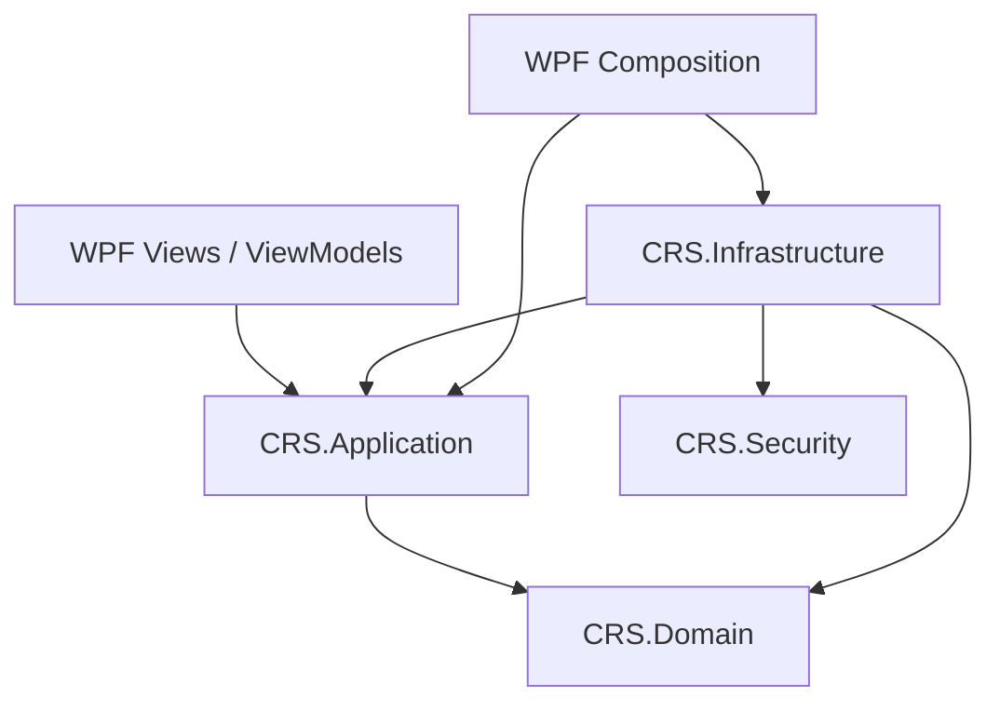

# 旧安全模块结构提案

> 这是原规划文本，含已过时的未实现标记。现状见 [项目结构](../architecture/PROJECT_STRUCTURE.md)。

## 安全模块的目标架构（五个生产项目，尚未实现）

**已决定新增 `CRS.Security` 独立类库**。当前四项目源码以及已有的 `Infrastructure/Security/` 目录仍按“当前结构”描述；安全能力尚未落地，不能把本节目标树当作已完成事实。详细规范见 [SECURITY_DESIGN.md](../specifications/SECURITY_DESIGN.md)，新增离线 MFA 认证详见 [SECURITY_AUTH_SPEC.md](../specifications/SECURITY_AUTH_SPEC.md)。

```text
CRS/
├─ src/
│  ├─ CRS.Domain/                   # 保持现有 FIFO、税额和交易事实规则
│  ├─ CRS.Application/
│  │  ├─ Abstractions/              # 规划：保险库生命周期、解锁状态、备份/恢复端口
│  │  └─ Workflows/                 # 规划：调用 Application 端口的业务流程
│  ├─ CRS.Security/                 # 【新增独立项目】纯加密与密钥核心
│  │  ├─ Cryptography/
│  │  │  ├─ KeyDerivation/          # Argon2id KDF
│  │  │  ├─ KeyWrapping/            # AES-256-GCM / Key Envelope
│  │  │  └─ Randomness/             # 随机 DEK 和恢复密钥
│  │  ├─ Vault/                     # 密钥封装对象与格式验证，不读写 SQLCipher
│  │  ├─ Recovery/                  # 恢复凭证的密码学操作
│  │  └─ Authentication/            # 【规划】RFC6238 TOTP、二维码URI、随机恢复码纯机制
│  ├─ CRS.Infrastructure/
│  │  ├─ Security/                  # 实现 Application 端口；会话/密钥操作适配、TOTP受限认证及原子防重放
│  │  ├─ Persistence/               # SQLCipher、格式识别、明文拒绝、数据库完整性
│  │  ├─ Backup/                    # 版本化加密备份文件与恢复适配
│  │  └─ Composition/               # 装配 Application / Security / Infrastructure
│  └─ CRS.Desktop.Wpf/
│     ├─ Views/                     # 新建、解锁、恢复、旧库拒绝等视图（规划）
│     ├─ ViewModels/                # 仅调用 Application 用例，不读取 DEK
│     └─ Composition/               # 桌面启动装配
└─ tests/
   ├─ CRS.Tests.Security/          # 【新增】密码派生、密钥封装/恢复、拒绝边界
   ├─ CRS.Tests.Infrastructure/     # SQLCipher/备份/文件识别集成验证
   └─ Verify-Architecture.ps1      # 新增第五项目的引用规则检查
```

**目标项目引用：**

| 项目 | 允许引用的 CRS 项目 | 禁止事项 |
| --- | --- | --- |
| `CRS.Domain` | 无 | 不依赖安全、桌面和持久化程序集 |
| `CRS.Application` | `CRS.Domain` | 不引用 `CRS.Security` / `CRS.Infrastructure` / WPF |
| `CRS.Security` | 无 | 不引用 Domain / Application / Infrastructure / WPF / SQLCipher / Dapper |
| `CRS.Infrastructure` | `CRS.Application`、`CRS.Domain`、`CRS.Security` | 不依赖桌面项目，不将 SQLCipher 实现放进 `CRS.Security` |
| `CRS.Desktop.Wpf` | `CRS.Application`、`CRS.Infrastructure`（启动装配） | Views/ViewModels/Controls 不直接访问 Infrastructure 或 `CRS.Security`；不持有裸 DEK |



**职责边界：** `CRS.Security` 负责可单独测试的密码学机制（Argon2id、密钥生成、AES-GCM 封装、恢复凭证）；`Infrastructure/Security` 只是接口适配与保险库会话编排，SQLCipher、磁盘文件及备份 I/O 留在 Infrastructure。`VaultId` 仅用于保险库身份，不取代按券商/账户/证券/币种隔离的业务身份键。新增 `CRS.Security` 不意味着实现在线账户、订阅或多租户服务。

**认证新增边界：** 首次／恢复由主密码解封 DEK，日常由 Infrastructure 的 DPAPI CurrentUser 本机槽准备受限认证；完成 TOTP 原子消费后才授予业务会话。Application 不引用 Security，WPF 非 Composition 层不接触 SQLCipher 或密钥。保持 10 分钟锁定；独立数据库恢复密钥与一次性手机恢复码用途分开，便携备份不含本机 Windows 槽。

**兼容边界：** 当前使用 SQLCipher，业务 `user_version=2` 与独立认证版本分别验证。只对已识别的加密 v1 业务结构执行备份及事务升级；安全版本**发现明文库即拒绝读取，不做转换或迁移**。只能在用户明确指定的空目录创建或恢复加密保险库，不删除或覆盖旧明文库与 WAL/SHM。认证准入规则独立于业务结构升级。Application 保持已有的导入、计算、冻结历史、复算与导出门槛。
