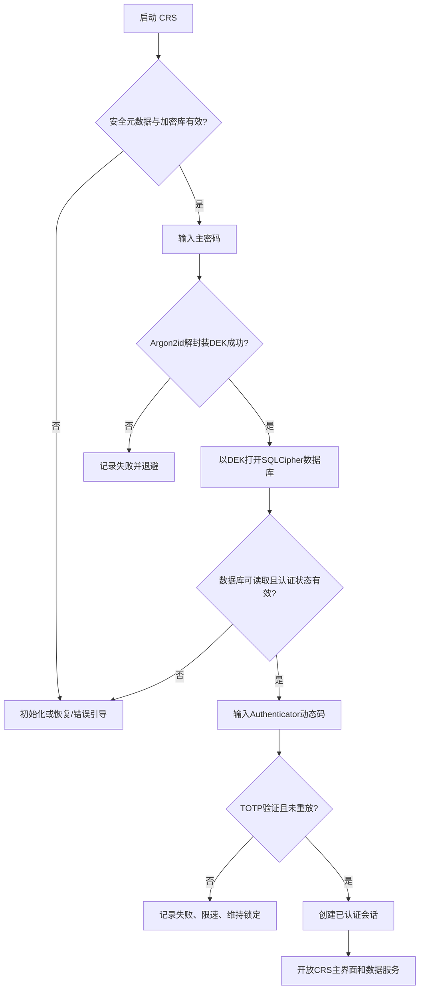

# CRS 项目离线身份认证与数据安全整改规范

> 文件名：`CRS_OFFLINE_AUTH_SECURITY_REMEDIATION.md`  
> 文档状态：**开发整改基线（待项目代码核对后实施）**  
> 编制日期：2026-10-13  
> 目标技术栈：.NET 10 / WPF / Windows / SQLCipher 加密 SQLite  
> 适用范围：CRS 本地桌面应用的初始化、登录、会话、安全操作、密钥、备份与恢复  
> 不包含：在线微软账号登录、Entra ID、联网授权服务器、云端身份中心

---

## 0. 结论及执行口径

**保留此前选定的 Microsoft Authenticator（标准离线 TOTP），不要改为在线微软账号认证。** 对 CRS 增加“主密码负责解密，TOTP 负责额外认证，Windows Hello 负责短时会话确认”的分层方案。

### 0.1 已确定的项目约束

1. **完全离线**：应用在首次初始化、日常登录、TOTP 核验、备份及恢复时均不得要求互联网访问。
2. **单机、单用户优先**：不引入账号注册、服务端用户体系、云端验证码、许可证服务器。
3. **持久化数据库必须是 SQLCipher 加密 SQLite**：禁止创建或继续使用明文 SQLite 数据库。
4. **不提供明文 SQLite 原地加密迁移**：检测到旧明文库，应提示该版本不支持并允许用户另存原文件后创建新加密库；**不得静默删除或覆盖旧文件**。
5. **原始交易数据、成本计算记录、导入附件及导出报表属于敏感数据**：身份认证不能代替文件加密与导出保护。
6. 实际工程层次、SQLite 驱动、DI 容器、配置路径及原有加密实现，**在落地前从现有项目中确认**。下文的程序集名称属于建议，不代表现有代码已经具备。

### 0.2 范围与优先级

| 层次 | P0（第一期，必须） | P1（第二期，可选） |
|---|---|---|
| 数据解密 | 主密码 + Argon2id + 随机 DEK + SQLCipher | 轮换与密钥格式版本化增强 |
| 登录认证 | Microsoft Authenticator 兼容 TOTP | Windows Hello 短时重新验证 |
| 会话保护 | 空闲锁定、系统锁屏硬锁、敏感数据遮挡 | 软锁/硬锁分级体验 |
| 账号救援 | 一次性恢复码重绑 TOTP | 恢复操作可视化与引导 |
| 设备迁移 | 独立恢复口令保护的离线加密备份 | 增量备份/轮替保留策略 |
| 可追溯性 | 不含秘密的安全事件日志 | 可视化事件审计 |

**P0 放行条件**：主密码/TOTP 登录、无明文 SQLite、手机丢失恢复、系统重装恢复、错误密钥与篡改拒绝，以及核心负向测试全部通过。

---

## 1. 安全模型与边界

### 1.1 身份因子不等于数据库密钥

| 概念 | 解决的问题 | 不解决的问题 |
|---|---|---|
| 主密码（Master Password） | 派生 KEK，解封装数据库 DEK，构成数据离线机密性的基础 | 无法独立防止正在运行中的恶意进程读内存 |
| TOTP（Microsoft Authenticator） | 对**已能解密数据的使用者**增加第二道本地认证门槛 | 不可直接作为 SQLCipher 密钥，也不能阻止有能力篡改本机程序的管理员 |
| Windows Hello | 对现有会话的操作者进行设备本地验证 | 普通“验证成功”接口**不返回**数据库解密密钥 |
| SQLCipher | 保护静态数据库文件及受其控制的数据库页面 | 不自动保护另行导出的 CSV、日志、截图和明文临时文件 |
| 恢复码 | 手机丢失时重新绑定 TOTP | **不能**在不知道主密码时单独解密数据库 |
| 加密备份恢复口令 | 跨电脑/重装系统恢复加密数据和 DEK | 是独立高价值秘密，丢失可能导致备份无法恢复 |

**威胁模型假设**：主要防范设备遗失、一般用户误操作、离线文件拷贝、弱口令暴力尝试及手机更换造成的锁定。对拥有本机管理员权限、能注入/替换程序或检查运行进程内存的攻击者，纯离线桌面应用不能给出强对抗保证。不能在产品宣传中把“离线 TOTP”表述为防本机管理员破解。

### 1.2 核心密钥分层（强制）

```text
主密码 ── Argon2id(salt, 参数) ──> KEK (内存中短时存在)
                                      │
                                      └── AES-256-GCM 解封装 DEK
                                                              │
                                                              ├── SQLCipher 加密 CRS 数据库
                                                              └── 可选：派生子密钥保护特定本地秘密

TOTP 种子（20字节及以上随机值）── 加密数据库保存 ──> 验证动态码
恢复码的验证记录 ───────────── 加密数据库保存 ──> 单次消费

离线备份恢复口令 ── 独立 Argon2id ──> 备份 KEK ──> 加密备份载荷
```

- DEK：使用 OS CSPRNG 生成的 **32 字节随机数据库密钥**；不能从机器名、MAC、用户名、安装 GUID 或固定口令推导。
- KEK：使用主密码经 Argon2id 派生。不同用途使用**独立 salt / 参数 / purpose**，不可复用主密码派生结果到备份保护。
- DEK 使用经过认证的加密算法（建议 AES-256-GCM）封装；每次封装随机 nonce，AAD 至少绑定 `formatVersion`、`dataId`、`keyId`、`purpose`。
- 本地密码修改只需要**重新封装相同 DEK**，不应为了改密码而执行整库 `PRAGMA rekey`；仅在怀疑 DEK 泄漏或计划进行真正的数据库密钥轮换时才重新加密数据库。
- 不得把 DEK、KEK、主密码、TOTP 种子、恢复口令写入源代码、`appsettings.json`、注册表明文、诊断日志、异常栈、崩溃上报或命令行参数。
- SQLCipher 的原始 256-bit 密钥输入须严格按官方的 raw-key API/格式实现并测试，不得把十六进制字符串误当作普通口令而产生不一致的 KDF 行为。

### 1.3 Argon2id 参数基线

建议默认参数：`memory=64 MiB, iterations=3, parallelism=1`；在目标最低配置 Windows PC 实测登录耗时，允许提高参数但不允许低于 OWASP 当前建议的最小安全配置 `19 MiB / 2 次 / 并行度1`。每份密钥封装应记录 `algorithm`、`salt`、`memoryKiB`、`iterations`、`parallelism`、`keyLength`，以便后续升级。

参数配置应防止恶意文件诱导超量内存占用：解析外部元数据时先设置允许的最大内存和迭代上限，禁止直接信任备份内声明的任意 KDF 参数。

---

## 2. 初始化与数据状态机

### 2.1 首次运行

1. 检查安全元数据和数据库文件。**不存在**才进入首次初始化；已存在但不一致属于“损坏/部分初始化”而不是新安装。
2. 用户设置主密码：建议最少 12 个字符，允许长口令及粘贴密码管理器内容，不施加不合理复杂度规则；双次确认。
3. 生成随机 DEK；以主密码经 Argon2id 派生 KEK，封装 DEK；在事务/原子文件提交策略中创建 SQLCipher 加密数据库。
4. 生成随机 TOTP 种子，通过 `otpauth://totp/...` URI 展示二维码，注明 **CRS (Local)**；二维码仅展示在绑定界面，不写入持久化日志或图片文件。
5. 用户用 Microsoft Authenticator 的“其他账户”扫描二维码（也应兼容标准 TOTP App）；输入首个动态码成功后才将绑定状态置为 `Bound`。
6. 生成 **10 组**一次性高熵恢复码（每组至少 128 bit 的 CSPRNG 随机熵，显示为分组便于抄写）；展示一次，建议打印或存入离线安全位置。
7. 用户确认已保存恢复码，并执行一次恢复码确认测试（测试不能消费正式恢复码；可指定显示码之一验证后立即以新码替换），最终以原子方式提交初始化完成标记。
8. 提供创建首份离线加密备份的引导，并要求设置**独立于主密码的恢复口令**；建议强密码且存放于安全位置。

> **初始化中断**：如果程序在创建 DEK、写库、绑定 TOTP 或生成恢复码中途崩溃，重启时应识别 `Initializing / Ready / NeedsRepair`，只允许明确的继续/重置空库流程；不自动越过绑定确认，也不自动删除含数据文件。

### 2.2 数据库存在性与格式检查

| 状态 | 行为 |
|---|---|
| 数据库及密钥元数据都不存在 | 显示初始化向导 |
| 已加密数据库与匹配的安全元数据存在 | 进入完整解锁 |
| 有数据库但安全元数据缺失 | 拒绝当作新库覆盖；引导用户找备份，提供只读诊断 |
| 有安全元数据但数据库缺失 | 拒绝静默新建；引导恢复备份或人工明确重置 |
| 检测到旧**明文 SQLite** | 提示不支持迁移；允许只备份旧文件并在**新文件路径**创建加密数据库，旧文件不删除不覆盖 |
| 格式未知/损坏/口令错误 | 区分可判断的错误类型；无法确定时统一提示，不做自动修复写入 |

格式检测不能仅凭 SQLite 头部或某一个字节判断有效性；已加密库必须在正确密钥解封装后执行 SQLCipher 可读性/完整性校验。不得把“打不开”直接解释成“明文库”。

---

## 3. 完整登录与离线 TOTP

### 3.1 登录顺序（不得倒置）



**重要**：由于 TOTP 种子保存在加密数据库中，技术上必须先通过主密码取得 DEK 并打开数据库，再校验 TOTP。校验成功前，业务查询、导入处理、主界面敏感内容、历史记录和导出功能必须全部隔离；不得把“数据库可打开”误认为“用户已通过登录”。

### 3.2 TOTP 规范

- 采用兼容 RFC 6238 的标准 TOTP；默认 `SHA1 / 6 位数字 / 30 秒步长` 以确保通用 App 兼容；这只用于 TOTP，不用于主密码存储。
- 种子至少 160 bit 随机值；存储在 SQLCipher 加密数据库中，可按需要增加应用层封装；二维码不得持久化。
- 验证窗口默认 `[-1, 0, +1]` 时间步，以兼顾少量设备时钟漂移。时钟漂移超限须提示用户校正手机与电脑时间；绝不通过联网时间服务器隐式破坏离线设计。
- 同一认证上下文中，已接受的时间步不得再接受，需持久化 `lastAcceptedTotpStep` 等防重放状态；并发验证必须在事务内完成“检查+消费”。
- 比较验证码时采用常量时间比较；记录是否成功、时间与失败原因类别，**不记录实际验证码或种子**。
- 一般认证失败累计 5 次后应用退避（例如 30 秒），继续失败逐步延长，最大 15 分钟；不要仅用界面倒计时限制，所有业务入口都统一检查节流状态。
- 若系统时间被倒调、程序被重新安装或数据库被回滚，完全离线场景不能保证绝对防重放；提供风险提示和诊断而不是做出绝对保证。
- 不支持 Microsoft Authenticator 的在线“批准登录”推送模式，不要求 Microsoft 账号；只使用标准离线验证码功能。

### 3.3 主密码错误处理

- 使用 AES-GCM 标签校验是否正确解封装密钥（不可仅比较明文哈希决定能否打开库）。
- 禁止因连续失败自动清库、删除密钥或永久锁死唯一合法用户。
- 安全日志存储有限信息，不泄漏本地路径、账号持仓与密钥信息。
- 安全限流是附加控制，离线密钥文件一旦被复制，仍需要**足够强的主密码 + KDF**抵御离线猜测。

---

## 4. 会话锁定与 Windows Hello

### 4.1 P0：先实施可靠的硬锁

- 无活动 **10 分钟**锁定界面（配置值可调，默认 10 分钟）。
- Windows 会话锁定、用户注销、休眠/待机、应用退出及进程异常恢复：默认**硬锁**；关闭数据库连接，撤销认证状态，尽力清空托管/原生敏感缓存和内存密钥。
- 硬锁后的解锁仍需 **主密码 + TOTP**（或在“已输主密码后”用一次性恢复码进入绑定修复流程）。
- 锁定时隐藏持仓、交易表、导入预览、税务结果、搜索缓存和可复制数据；阻止后台导出/报表任务在未经授权的会话中继续读取数据。
- 异步后台作业必须携带授权会话快照或短期授权票据；锁定时取消/终止敏感任务，不能依赖 UI 按钮禁用实现授权。

### 4.2 P1：Windows Hello 仅作为会话快速解锁

建议后续增加两级会话：

| 级别 | 触发条件 | DEK 状态 | 解除方式 |
|---|---|---|---|
| 活跃会话 | 刚完成主密码 + TOTP | 仅在受控进程内存中短期使用 | 无须重复认证 |
| **软锁** | 空闲满 10 分钟，且未发生 OS 锁屏/睡眠 | 仍存在于本进程内存（承认相应风险） | Windows Hello 成功才放开 UI；失败转完整解锁 |
| **硬锁** | OS 锁屏、睡眠、退出，或软锁再持续 20 分钟 | 关闭连接并尽力清除 DEK | 主密码 + TOTP |

> 在 P1 上线前可**统一按硬锁**实现，更简单、更安全。P1 的软锁功能是明确选择的用户体验与内存驻留风险交换，不可把它写成“Windows Hello 独立解密数据库”。

- WPF 桌面端参考 `Windows.Security.Credentials.UI.UserConsentVerifierInterop.RequestVerificationForWindowAsync(hwnd, message)`；不是直接复制 UWP 的 `RequestVerificationAsync` 示例。
- 检查 Windows Hello 可用状态；不支持、未配置、被策略禁用、用户取消或调用失败时，回退完整解锁，**不得回退无认证**。
- 若以后要实现 Hello 在关闭应用后独立解密，需另立设计评审，讨论**密钥绑定、硬件保护和恢复语义**；普通 UserConsentVerifier 结果本身不提供密钥保管能力。
- Windows Hello PIN 属于设备本地验证机制，不等于把用户的 CRS 主密码保存到 Windows 登录账户。

### 4.3 敏感操作的“提高验证等级”

以下操作默认要求在最近 **2 分钟**内完成一次新的 TOTP 验证（允许连续业务动作复用一次短时授权，但不能复用已消费验证码）；高级场景可增加主密码重新确认：

1. 关闭/重置 TOTP、生成新恢复码；
2. 修改主密码、轮换 DEK；
3. 导出完整交易明细、生成不加密的 CSV/Excel/PDF；
4. 恢复备份、覆盖当前数据库、删除全部本地数据；
5. 更改关键安全设置（闲置锁定时长、备份保护策略）。

即使 Windows Hello 成功，也不能自动跳过这些高风险操作所要求的 TOTP 重新验证。

---

## 5. 手机丢失与恢复码

### 5.1 恢复码格式与存储

- 初始化生成 **10 组**一次性恢复码，每组至少 128 bit CSPRNG 熵；避免使用短数字口令冒充恢复码。
- 仅展示一次；支持复制/打印，但显式提示剪贴板、打印机和截图风险。
- 数据库存放随机盐 + 恢复码验证摘要或等效安全验证记录，**不保存明文恢复码**；高熵随机恢复码可使用加盐 SHA-256/HMAC 做校验，使用常量时间比较和原子消费。
- 任意恢复码验证通过后立即标记 `Consumed` 并持久化；并发输入不得重复使用。
- 重新生成恢复码会作废全部旧码；不允许查看旧码明文。

### 5.2 手机丢失时的操作流程

```text
输入主密码，解封装 DEK
  -> 打开 SQLCipher 数据库（业务界面仍不可用）
  -> 选择「无法使用验证器」
  -> 输入一组尚未使用的恢复码
  -> 消费恢复码并进入受限制的「重新绑定 TOTP」流程
  -> 生成新种子、展示新二维码、验证新 App 的动态码
  -> 作废旧种子和剩余旧恢复码、生成10组新恢复码
  -> 用户确认保存 -> 提交新绑定 -> 创建正式会话
```

**不可接受的行为**：通过恢复码跳过主密码、直接显示敏感业务界面、仅凭知道 Windows 登录 PIN 重置 TOTP，或通过删除配置文件关闭第二因素。

### 5.3 遗忘主密码

恢复码**不提供主密码重置/数据库解密能力**。若主密码丢失，只能使用事先生成且知道其**独立恢复口令**的离线加密备份，恢复后设置新主密码。若主密码、备份恢复口令与可用密钥都丢失，必须明确告知数据不可恢复，不可承诺“找回”。

---

## 6. 跨电脑、重装系统与离线加密备份

### 6.1 备份文件格式（建议 `.crsbak`）

采用版本化、可移植格式，示意结构：

```text
CRS-BACKUP-V1
  header（公开且经认证绑定）
    formatVersion, cryptoSuite, createdAt, dataId, backupId,
    argon2id(salt, memoryKiB, iterations, parallelism), nonce,
    payloadLength
  encryptedPayload（AES-256-GCM）
    - SQLCipher 一致性数据库快照（仍是密文）
    - DEK 的恢复封装内容 / 必需 key metadata
    - manifest：DB schemaVersion、应用版本、备份内容校验信息
  authTag
```

要求：

1. 备份恢复口令使用独立 salt 的 Argon2id 生成备份 KEK；备份载荷采用 AEAD 完整性保护，header 作为 AAD；不能只做“ZIP 设置密码”。
2. 备份中包含正确恢复数据库所需的 **DEK 或其可恢复封装**，但只能在备份口令通过后访问；不得在备份头部明文存放 DEK。
3. 备份制作必须以 SQLCipher/SQLite **一致性快照机制**完成，不能在数据库运行时盲目拷贝主库文件而忽略 WAL；不产生遗留明文数据库临时副本。
4. 备份写入 `*.tmp`，完成完整性校验后原子重命名；失败需清理临时文件且保留旧备份。
5. 支持保存到用户指定目录/U盘；默认保存位置提醒不要和唯一数据库在同一物理磁盘上。
6. 加密备份也可能含持仓、交易、TOTP 种子等秘密信息，必须视为高度敏感文件。
7. 备份前后可进行校验，但“能够打开备份头”不等于“已经完成完整恢复测试”。

### 6.2 新电脑恢复顺序

```text
新电脑安装 CRS
  -> 选择「从加密备份恢复」
  -> 导入 .crsbak 并校验格式与资源限制
  -> 输入独立的备份恢复口令
  -> 解密载荷、获取 DB 快照与 DEK
  -> 检验快照/SQLCipher 可用性/业务schema兼容性
  -> 在新电脑上设置新的 CRS 主密码，并重新封装 DEK
  -> 完成 TOTP 校验（原手机仍在）
        或 主密码 + 未使用恢复码重新绑定（手机丢失）
  -> 验证成功后原子切换到恢复后的数据库
```

- 原电脑的 DPAPI 数据和 Windows Hello 绑定状态**不能当成可移植依赖**。
- 恢复时若当前存在数据库，必须告知覆盖影响，先制作可恢复的安全备份，再执行临时目录恢复和原子切换；**禁止直接覆盖正在使用中的文件**。
- 恢复后旧快照可能造成 TOTP 已用时间步、恢复码消费状态等回滚。纯离线应用无法在所有情况下识别历史快照回滚，必须在界面提示重新绑定 TOTP、轮换恢复码，并记录恢复事件。**建议恢复完成后强制轮换 TOTP 种子和恢复码**（需旧 TOTP 或有效恢复码完成授权）。
- 备份恢复口令相当于数据恢复能力，应比日常主密码更谨慎保管；只要掌握此口令及备份文件，即具备恢复和访问数据的潜在能力，不能把 TOTP 宣传成对加密备份的绝对防护。

### 6.3 DPAPI 的限定用途

- Windows `ProtectedData` 的 `CurrentUser` 可保护**设备本地的辅助设置**，但不能作为数据库 DEK 的唯一备份或跨设备恢复路径。
- 默认**不缓存一个能够完全绕过主密码解密数据库的 DPAPI-DEK 副本**；否则本地同用户进程可能在无需主密码时解封装它，违反主密码的主要保护目标。
- 严禁使用 `LocalMachine` 范围保护主数据库密钥（除非另有经审查的明确多用户设计）。

---

## 7. 安全事件与敏感数据生命周期

### 7.1 安全审计事件（建议结构）

```text
SecurityEvent {
  eventId, occurredAtUtc, eventType, outcome,
  sessionIdHash, appVersion, reasonCode,
  metadataSchemaVersion
}
```

至少记录：首次初始化、主密码解锁成功/失败、TOTP 成功/失败、恢复码消费、TOTP 重新绑定、恢复码轮换、主密码修改、备份创建/恢复、导出申请/完成、自动硬锁与解锁、数据库完整性异常。

不得写入：主密码、原始 DEK、TOTP 种子/二维码、实际验证码、恢复码、完整证券交易行数据、可直接识别客户/账户的敏感标识。审计日志可采用在数据库内加密存储；外部诊断日志必须脱敏且没有密钥内容。

### 7.2 业务数据泄漏面清单

- 交易数据导入过程的中间 CSV/Excel、解析缓存；
- CRS 主窗口、任务栏预览、最近打开文件列表、Windows 剪贴板；
- PDF、Excel、CSV、打印和导出目录中的**明文结果**；
- 异常日志、SQL tracing、崩溃 dump、临时目录；
- Windows 搜索索引、云盘自动同步目录与 Windows 用户配置文件漫游；
- 数据库 WAL/SHM、SQLCipher 数据库导出的临时文件与第三方组件缓存。

整改原则：**不在应用不受控目录落地明文敏感数据**；必须生成明文导出时由用户明确选择，提供风险提示，不能假称导出文件仍由 SQLCipher 保护。避免存储主密码 `string` 的长生命周期引用；能使用可清除内存缓冲时尽量使用，完成使用后清除。对 .NET GC、Windows 页面文件与异常转储中的历史数据，说明无法实现绝对清零。

---

## 8. WPF/.NET 工程改造结构

> 以下是**建议目标结构**；不要在尚未确认现有程序集命名的情况下机械重命名已有模块。保持 Domain 不依赖 WPF、Windows Hello 或 SQLCipher。

```text
Crs.Wpf                     # Login/Setup/Lock/Recovery/Settings 页面与 ViewModel
Crs.Application             # 登录流程、授权策略、备份用例与会话协调
Crs.Security                # 认证策略、TOTP、恢复码、Argon2id、密钥封装、会话
Crs.Infrastructure          # SQLCipher 连接/备份、文件系统、日志、OS/WinRT 适配
Crs.Domain                  # CRS 税务/交易业务模型；不引用 WPF/WinRT
Crs.Tests.Security          # TOTP/密钥/恢复码单元测试
Crs.Tests.Integration       # 加密库/备份恢复/WPF流程集成测试
```

**模块依赖原则**：UI → Application → 安全抽象/Domain；Infrastructure 实现抽象并通过 DI 注入。不要把 `PasswordBox` 输入比对、TOTP 算法、`PRAGMA key` 拼接、恢复码校验写进 `MainWindow.xaml.cs`。

### 8.1 服务接口草案（语义合同，不是可直接编译的最终代码）

```csharp
public interface IAuthenticationService
{
    Task<UnlockResult> UnlockDatabaseAsync(SecureSecret masterPassword, CancellationToken ct);
    Task<AuthenticationResult> VerifyTotpAsync(string code, CancellationToken ct);
    Task<RecoveryResult> BeginTotpRecoveryAsync(SecureSecret recoveryCode, CancellationToken ct);
    Task LockAsync(LockReason reason, CancellationToken ct);
}

public interface IKeyEnvelopeService
{
    Task<WrappedKeyRecord> CreateWrappedDataKeyAsync(SecureSecret password, CancellationToken ct);
    Task<DataKeyHandle> UnwrapDataKeyAsync(SecureSecret password, CancellationToken ct);
    Task ChangeMasterPasswordAsync(SecureSecret oldPassword, SecureSecret newPassword, CancellationToken ct);
}

public interface ITotpService
{
    TotpEnrollment CreateEnrollment();
    TotpVerifyResult VerifyAndConsume(string code, DateTimeOffset utcNow);
}

public interface IRecoveryCodeService
{
    RecoveryCodeBatch IssueAndReplaceAll();
    bool TryConsume(SecureSecret code);
}

public interface ISessionLockService
{
    SessionState Current { get; }
    Task HardLockAsync(LockReason reason, CancellationToken ct);
    Task<bool> TrySoftUnlockWithHelloAsync(CancellationToken ct);
}

public interface IEncryptedBackupService
{
    Task CreateBackupAsync(string destinationPath, SecureSecret backupPassphrase, CancellationToken ct);
    Task<RestorePreview> InspectBackupAsync(string backupPath, CancellationToken ct);
    Task RestoreAsync(string backupPath, SecureSecret backupPassphrase,
                      SecureSecret newMasterPassword, CancellationToken ct);
}
```

`SecureSecret` / `DataKeyHandle` 为项目自行实现的、可清除的敏感缓冲或密钥句柄抽象，必须规定所有权和 `Dispose` 行为；它们不是 .NET 内置类型。ViewModel 禁止保存密码至普通可序列化属性或日志。接口的 `VerifyAndConsume` 在实际落地中必须结合持久化事务或安全仓储抽象确保原子性。

### 8.2 主要 WPF 界面清单

| 页面 / 对话框 | 关键功能 | 失败状态 |
|---|---|---|
| `SecuritySetupWizard` | 设置主密码、绑定二维码、保存恢复码、创建备份 | 中断后保持 `Initializing` |
| `MasterUnlockView` | 主密码、显示/隐藏、错误退避 | 错误密码不泄漏库状态 |
| `TotpVerifyView` | 6 位数字、设备时间提示、恢复入口 | 失败次数/倒计时 |
| `SessionLockedView` | 锁定遮罩，P1 可选 Hello | 不可访问后台业务视图 |
| `RecoveryCodeView` | 恢复码认证、重绑 TOTP | 不可直接进入业务界面 |
| `SecuritySettingsView` | 修改密码、重绑、恢复码换发、锁定策略 | 高风险操作二次认证 |
| `BackupRestoreWizard` | 备份/预检/恢复、风险确认 | 失败不得破坏原库 |

### 8.3 DI 与防绕过控制点

1. 业务查询服务所有入口都要求 `SessionState == Authenticated`；敏感接口使用独立授权策略，不能只用 ViewModel 的 `IsEnabled`。
2. SQLCipher 连接工厂只接受 `DataKeyHandle`，禁止无密钥打开数据库；应用业务服务不得自己实例化 SQLite 连接绕开工厂。
3. 每次启动检查实际 SQLCipher 引擎版本（`PRAGMA cipher_version`）、有效开库及业务 schema；不能把普通 SQLite 驱动伪装成成功加密。
4. 本地配置元数据在文件系统中使用当前用户 ACL，仅是附加防护；安全核心依赖密码与加密认证标签。
5. 与现有导入、FIFO 税款计算、汇率缓存、导出模块逐一检查：是否可能在未认证、已锁定或执行恢复过程中绕过授权读取数据。

---

## 9. 变更实施顺序与禁止事项

### 9.1 第一阶段 P0（必须先落地）

- [ ] 盘点现有 SQLite 驱动、SQLCipher 版本、密钥存放方式、历史库格式及现有 TOTP 实现。
- [ ] 明确 `security metadata` 与数据库的一致性规则，设计 `Initializing / Ready / NeedsRepair` 状态。
- [ ] 实现 `DEK + Argon2id KEK + AES-GCM envelope`，包含密码变更原子操作。
- [ ] 实现 TOTP 绑定、验证、时间步防重放、失败退避及实际认证会话。
- [ ] 实现强制硬锁、取消敏感后台任务和全入口授权检查。
- [ ] 实现10组高熵恢复码、单次消费、丢失手机重新绑定。
- [ ] 实现可移植的 `.crsbak` 加密备份及换电脑恢复，实际执行一次恢复演练。
- [ ] 明文 SQLite 拒绝支持；不提供自动迁移/自动删除/自动覆盖。
- [ ] 清理导入、导出、日志、缓存和临时文件泄漏面。
- [ ] 完成下方 P0 验收用例并输出测试记录。

### 9.2 第二阶段 P1（用户体验优化）

- [ ] WPF 集成 Windows Hello `UserConsentVerifierInterop` 并处理所有失败枚举。
- [ ] 引入可配置软锁/硬锁，风险提示明确“软锁期间密钥仍在内存”。
- [ ] 安全事件界面、认证状态提示、备份恢复向导完善。
- [ ] 恢复后强制 TOTP 与恢复码轮换的可用性流程完善。

### 9.3 明确禁止的实现

- **禁止**以 Windows Hello 用户验证成功替代持久化 DEK 解密方案。
- **禁止**将 TOTP 的 6 位码、绑定种子或固定机器 ID 用作数据库密钥。
- **禁止**将数据库 DEK 写死在程序中，或存入未加密设置文件。
- **禁止**将 DPAPI `CurrentUser` 包裹的 DEK 设计为唯一跨设备恢复途径。
- **禁止**把所有权限校验只放在 WPF 按钮上。
- **禁止**因用户输入错误、缺少元数据或明文旧库就删除/覆盖现有文件。
- **禁止**把恢复码设计为绕过主密码。
- **禁止**把“通过 Authenticator”宣称为“数据文件已经加密”。

---

## 10. 验收标准与测试用例

### 10.1 P0 功能 / 安全验收矩阵

| ID | 场景 | 期望结果 |
|---|---|---|
| AUTH-001 | 全新电脑首次启动 | 进入初始化而非主界面；必须设置主密码、绑定 TOTP、生成恢复码 |
| AUTH-002 | 无网且手机无网络时登录 | 主密码+本地 TOTP 正常工作，不出现联网请求 |
| AUTH-003 | 主密码错误 | 不得到 DEK，不打开业务数据；触发退避；原数据不变 |
| AUTH-004 | TOTP 错误 | 不授权主界面/查询/导出，即使数据库在内部已经解锁 |
| AUTH-005 | 同一 TOTP 时间步重放 | 一次验证成功后再输入相同时间步的码被拒绝 |
| AUTH-006 | 时间偏差 ±1 步 | 按配置容差工作；过大偏差提示校时 |
| AUTH-007 | 失败登录跨窗口/重启 | 所有入口受统一限流与授权控制；不靠 UI 层单独计数 |
| AUTH-008 | 空闲超过10分钟 | 页面锁定、敏感视图遮挡、查询/导出被拒绝 |
| AUTH-009 | Windows 锁屏/睡眠/退出 | 执行硬锁，恢复时完整认证 |
| AUTH-010 | 手机丢失但有主密码+恢复码 | 可重绑 TOTP；旧种子失效，旧恢复码全部失效 |
| AUTH-011 | 仅有恢复码无主密码 | 不能进入数据库及敏感业务界面 |
| AUTH-012 | 主密码更改 | 不执行无必要的全库 rekey；旧主密码失效，新密码生效 |
| AUTH-013 | 将加密库复制到另一机器但无密钥/口令 | 不能读取业务表和明文交易数据 |
| AUTH-014 | 检测到明文 SQLite 旧库 | 拒绝迁移；原文件保持完整，仅可显式创建新加密库 |
| AUTH-015 | 故意损坏 metadata、密文库或 AEAD tag | 拒绝认证/恢复；不静默初始化覆盖 |
| AUTH-016 | 备份中途断电/异常 | 既有数据库与先前备份不被破坏；无残留明文临时副本 |
| AUTH-017 | 新电脑恢复 `.crsbak` | 输入备份口令后可恢复，设置新主密码并完成 TOTP/恢复授权 |
| AUTH-018 | 旧电脑 DPAPI / Hello 信息无法使用 | 仍可凭可移植加密备份完成恢复 |
| AUTH-019 | 不同业务服务入口直接发起查询/导出 | 无 `Authenticated` 会话统一拒绝，而非仅禁用按钮 |
| AUTH-020 | 查看日志、诊断包、导出目录、临时目录 | 不包含主密码、TOTP 种子、DEK、恢复码或非预期明文交易内容 |
| AUTH-021 | 完整登录后重启进程 | 不保留可绕过主密码的默认设备缓存，需重新完整认证 |
| AUTH-022 | 恢复历史备份 | 需要显示快照回滚风险，并重新建立或轮换 TOTP/恢复码 |
| AUTH-023 | 恢复备份错误密码/损坏包/不兼容schema | 明确失败，不覆盖原数据库，安全资源上限生效 |
| AUTH-024 | 改密码、恢复、重绑、完整导出 | 二次认证策略按敏感操作要求触发 |

### 10.2 P1 Windows Hello 专项验收

| ID | 场景 | 期望结果 |
|---|---|---|
| HELLO-001 | 当前会话软锁且 Windows Hello 已配置 | 使用 Hello 成功可恢复**同一活跃会话** |
| HELLO-002 | Hello 不可用/取消/被系统策略禁用 | 不能绕过，进入完整解锁 |
| HELLO-003 | 进程退出或系统锁屏硬锁 | 仅凭 Hello 的布尔验证不能打开数据库 |
| HELLO-004 | Hello 成功后执行敏感导出 | 仍按安全策略要求新鲜 TOTP 二次验证 |

### 10.3 自动化与手工测试重点

- TOTP 用 RFC 6238 测试向量验证算法，再与**实际 Microsoft Authenticator App**测试二维码、时钟偏差与重复码。
- SQLCipher 测试覆盖正确/错误 raw key、主密码变更前后、`PRAGMA integrity_check` 和 `PRAGMA cipher_integrity_check`（按当前驱动与 HMAC 模式）以及备份一致性。
- 恢复测试必须至少覆盖：同机恢复、换 Windows 用户、换电脑、重装系统、丢失手机、仅剩独立备份口令；尤其验证不依赖原 DPAPI。
- 故障注入：初始化任何一步掉电、备份中断、恢复写盘失败、元数据更新到一半、数据库文件被替换/截断。
- 覆盖由快捷键、后台定时任务、导出 API、数据解析 API 绕过锁屏的场景。

---

## 11. 代码评审检查点与开发交付物

### 11.1 代码评审必须回答

1. DEK 在哪里生成？有哪些持久化副本？谁能拿到它？
2. 主密码错误时能够在任何路径得到 DEK 或原始交易数据吗？
3. TOTP 验证前，能否通过窗口事件、DI 服务、缓存或后台任务读取敏感数据？
4. TOTP 种子及恢复码在数据库外是否出现过明文副本？
5. 每一次登录、恢复码消费、密码重封装是否具有原子性？
6. 改密码是否会导致之前的备份失效？若备份口令独立，应当**不会**。
7. 旧库明文或 metadata 异常时，是否存在数据被覆盖的风险？
8. 备份在没有原电脑 DPAPI 和 Hello 状态时，能否真正恢复？
9. 日志、异常处理、导出路径有无敏感字段泄漏？
10. 团队是否明确文档中 P0 与 P1 的行为差异，并提供对应测试报告？

### 11.2 本轮应交付

- `CRS_OFFLINE_AUTH_SECURITY_REMEDIATION.md`（本规范）；
- 实际工程改造清单（按现有真实项目/类名逐项对应）；
- `SecurityEnvelope` 与 `.crsbak` 版本化格式说明及兼容策略；
- 首次初始化/完整登录/异常恢复的流程与状态机测试；
- 恢复码及 TOTP 单元测试与 SQLCipher 集成测试；
- **在全新 Windows 用户/设备上的恢复演练记录**；
- 现有旧密钥与已有加密数据库的升级方案（若项目已经生成正式加密数据）；
- 安全审查结论：P0 所有验收通过才能将本整改标记完成。

---

## 12. 与现有 CRS 文档的衔接建议

实施时，优先把本文件作为一份独立的**安全整改规范**，不要覆盖 `CRS开发规范.md` 或原有 TAX/FIFO/汇率业务规则。核对现有文档后逐项同步：

| 既有文档类别 | 需要同步的内容 |
|---|---|
| `CRS开发规范.md` / SAD | 安全层职责、DI 依赖、锁定状态、密钥封装与授权边界 |
| 数据库/加密规范 | SQLCipher 连接工厂、DEK 封装、明文 SQLite 拒绝策略、版本兼容 |
| 测试规范 `TEST_SPEC.md` | AUTH-001～024、HELLO-001～004、安全恢复故障注入 |
| 发布规范 `RELEASE_PLAN.md` | 新安装、升级旧加密库、数据备份、换电脑恢复、升级失败回退 |
| 导入导出/API规范 | 未认证访问拒绝、敏感导出二次验证、明文临时文件清理 |

**版本处理约束**：若现有加密格式已经上线，改造前先备份并确认可解密。禁止在还没有验证新版密钥封装可用时丢弃旧密钥元数据。该规则**不代表**允许迁移旧的明文 SQLite：明文旧库始终拒绝迁移，另建新加密库。

---

## 13. 技术依据（2026-10-13 核对）

1. Microsoft Authenticator 官方 FAQ（验证码离线可用，批准登录推送需联网）：  
   https://support.microsoft.com/en-us/authenticator/microsoft-authenticator-faqs
2. Windows Hello `UserConsentVerifier` 官方文档（WPF/桌面应用使用 `UserConsentVerifierInterop.RequestVerificationForWindowAsync`）：  
   https://learn.microsoft.com/en-us/uwp/api/windows.security.credentials.ui.userconsentverifier
3. .NET `ProtectedData`/DPAPI：  
   https://learn.microsoft.com/en-us/dotnet/standard/security/how-to-use-data-protection
4. OWASP Password Storage Cheat Sheet（Argon2id 参数底线）：  
   https://cheatsheetseries.owasp.org/cheatsheets/Password_Storage_Cheat_Sheet.html
5. SQLCipher 官方 API（密钥、rekey、完整性检查和导出）：  
   https://www.zetetic.net/sqlcipher/sqlcipher-api/
6. SQLCipher 官方密钥管理建议（不要硬编码/明文配置密钥）：  
   https://www.zetetic.net/sqlcipher/database-key-material/
7. RFC 6238 TOTP：  
   https://www.rfc-editor.org/rfc/rfc6238

> **重要说明**：以上为目标设计与整改验收规范，**不是**已完成的代码修改或安全审计结论。正式实现必须核对仓库中实际 SQLite 驱动、SQLCipher 发行版本、Windows Target Framework 和项目部署方式，不能只凭规范视为已达到安全要求。
